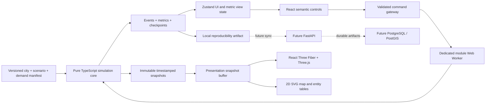

# CIVITAS — architecture

Status: Stage 00 design, not an implemented system. [Simulation semantics](simulation-spec.md) are authoritative.

## System boundary

The MVP is a browser-local, single-user application. Static assets and a bundled fictional scenario are sufficient to run it. There is no network request in the simulation tick path and no account, hosted database, paid map tile service, or paid API prerequisite.



Arrows from the interface express commands, never direct writes to vehicle state. Both renderers read the same snapshot contract. The Python service will store and validate artifacts; it will not introduce an independently coded traffic engine.

## Technology choices

| Technology | Responsibility | Boundary and rationale |
| --- | --- | --- |
| React + TypeScript | Semantic application shell, inspector, controls, error boundaries | TypeScript strict mode; React does not own the physics loop |
| Vite | Local development, production bundles, module worker packaging | Client application, no SSR requirement; run explicit type checking because Vite transpiles without type checking |
| React Three Fiber, R3F | Scene composition, picking, lifecycle | `useFrame` writes presentation transforms only |
| Three.js | Geometry, instancing, lighting, materials, WebGL2 renderer | Deliberate WebGL2 baseline; no WebGPU requirement |
| Zustand | Selection, panels, camera intent, acknowledged control state, low-frequency metric summaries | Excludes authoritative agent arrays and per-frame transform updates |
| Dedicated Web Worker | Scheduler, command ordering, core state ownership, replay runner | One authoritative state writer; no physics on the main thread |
| Plain TypeScript core | Routing, demand, vehicle integration, signals, metrics, state serialization | Runs headlessly in Node and inside a worker using the same module |
| Zod | Runtime validation at file and message boundaries | Compile-time types alone cannot validate an imported scenario |
| FastAPI, future | Versioned artifact and city catalog API | Optional separate service, not needed for the MVP |
| PostgreSQL + PostGIS, future | Relational versions, event manifests, spatial city data | Durable infrastructure, not tick-state coordination |

React 19 and R3F 9 form the planned pair. Official R3F documentation specifies their compatibility. Three.js's current `WebGLRenderer` requires WebGL2, so a WebGL1 promise would be incorrect. See [R3F installation](https://r3f.docs.pmnd.rs/getting-started/installation) and [Three.js WebGLRenderer](https://threejs.org/docs/pages/WebGLRenderer.html).

Exact proposed dependency pins and their compatibility caveat are in [the Stage 01 plan](stage-01-build-plan.md#dependency-baseline). R3F 10 alpha is outside this plan. Avoid installing a component library, chart framework, game engine, physics engine, general animation library, or postprocessing stack without a demonstrated need.

## Planned repository layout

This tree describes Stage 01 targets; only the dossier exists in Stage 00.

```text
apps/web/
  src/app/                   React shell, semantic views, error handling
  src/state/                 Zustand UI stores and selectors
  src/bridge/                Worker lifecycle, protocol adapter, snapshot buffer
  src/scene/                 R3F scene, instancing, picking, camera
  src/map/                   Independent SVG map and entity list
  src/styles/                Tokens, typography, responsive layout
packages/contracts/src/      Versioned schemas, IDs, units, message unions
packages/simulation/src/
  city/                      Validation and static graph compilation
  demand/                    Manifest generation and agent lifecycle
  routing/                   Stable shortest paths and closure versions
  traffic/                   Lane following, connectors, signals, reservations
  metrics/                   Tick accumulators and window reducers
  replay/                    Canonical serialization, checkpoint restore
  engine.ts                  initialize(), step(), applyCommand(), snapshot()
packages/simulation-worker/src/  Scheduler and message host
data/aster/                  Authored city and scenario inputs
tests/fixtures/              Small analytical scenarios and reviewed golden files
tests/e2e/                   Browser, worker, accessibility, fallback flows
scripts/                     Headless run, dependency audit, evidence report
docs/                        This dossier
services/api/                Future only; do not create in Stage 01
```

Use npm workspaces and a single lockfile. The core imports contracts only; contracts import neither React nor Three.js. Enforce these import directions in linting. Shared geometry contains numeric polylines, not `Vector3` instances. Tests must be able to import the core without a DOM, GPU, worker, or Zustand.

## Four separate kinds of state

| State | Owner | Examples | Persistence |
| --- | --- | --- | --- |
| Static model | Core, immutable after initialization | Graph, districts, buildings, movement geometry, manifest | Hashed versioned input |
| Authoritative simulation | Worker/core | Tick, lane occupancy, positions, routes, signal timers, closures, queues, metric accumulators | Checkpoints + canonical commands |
| Presentation | Main-thread renderer | Interpolated transforms, hover, fog, LOD, camera easing | Optional user preference; excluded from simulation hash |
| Application view | React/Zustand | Selected ID, filters, requested speed, acknowledged state, metric summaries | Preferences only; no duplicate traffic authority |

Worker snapshots are immutable views, not writable core objects. Do not put an entire simulation snapshot into a React state update every frame. Instanced mesh matrices update through renderer-local references. Zustand selectors subscribe to small stable slices. Its vanilla API can serve non-React consumers; see the [official Zustand repository](https://github.com/pmndrs/zustand).

## Command and observation protocol

Every envelope includes `protocolVersion`, `runId`, `epoch`, `requestId`, and a discriminated `type`. The epoch increases on reset, import, and seek; messages from an earlier epoch are discarded before reaching stores or renderers.

| Main to worker | Worker to main | Required behavior |
| --- | --- | --- |
| `INIT(city, scenario, manifest, expectedHashes)` | `READY(metadata, S0)` or `ERROR` | Validate all inputs before allocating a run |
| `PLAY`, `PAUSE`, `SET_SPEED(0.25/1/2/4)`, `STEP` | `CONTROL_ACK(mode, authoritativeTick)` | Acknowledgement controls displayed state; only one-tick step while paused |
| `SUBMIT(commandId, desiredTick?, intervention)` | `COMMAND_ACK(acceptedTick, seq)` or `COMMAND_REJECTED(reason)` | Accepted commands become immutable log entries |
| `EXPORT`, `IMPORT`, `RESET`, `SEEK(targetTick)` | `ARTIFACT`, `RESTORED`, progress or error | Restore paused; isolate old snapshots with a new epoch |
| `GET_DETAILS(entityId)` | `DETAILS(asOfTick, entity)` | Selection cannot mutate the core |
| Observation subscription | `SNAPSHOT`, `METRICS`, `EVENT_BATCH`, `STATUS` | Observation pressure cannot remove simulation ticks or events |

`SEEK` is a Stage 03 interface feature. Stage 01 implements reset-and-replay, plus internal checkpoint round-trip tests. Domain interventions currently consist of directed-lane close/open commands. Closing a physical road is an explicit atomic command containing both directed lane IDs.

Commands accepted at state `S_k` execute no earlier than transition `k+1`. Validate tick, target, topology version, and payload; deduplicate `commandId`; order accepted commands by `(acceptedTick, seq)`. Export preserves that order. Invalid or duplicate attempts never secretly mutate the model. Rejected attempts belong in a diagnostic transport log; only accepted domain commands determine replay.

Pause, camera motion, and execution speed are transport controls. They do not change the domain transition sequence or its hash. Record them separately for debugging. Mid-batch pause acknowledgements occur at a tick boundary; the UI shows a pending state until acknowledgement.

## Scheduling and synchronization

The core executes `S_(k+1) = step(S_k, commandsFor(k+1), dt=100 ms)`. The worker converts elapsed monotonic wall time into due ticks at the requested speed. It never passes variable wall time into `step`. A batch stops after 20 ticks or 8 ms of worker work, whichever comes first, then yields so commands can be handled.

Do not skip overdue simulation ticks. If the worker cannot sustain requested speed, report achieved speed and lag. A wall-time gap greater than 500 ms or a hidden document initiates a visible automatic pause at a tick boundary. Resume explicitly resets the wall-time anchor; there is no invisible background catch-up. Headless replay bypasses wall scheduling and steps an exact tick count.

Publish render snapshots every two ticks, or 5 Hz of simulation time, with an immediate snapshot for init, pause, step, reset, and an acknowledged intervention. At 4x this is at most 20 regular snapshots per wall second. Publish metric summaries every ten ticks, at most 4 Hz wall time. Derived events and commands remain complete even when visual snapshots are coalesced.

Maintain a small ordered presentation buffer. Its playhead is one regular snapshot interval, 200 simulated ms, behind the worker. For bracketing snapshots A and B:

```text
alpha = clamp((presentationTime - A.simTime) / (B.simTime - A.simTime), 0, 1)
position = sampleAuthoritativePath(A, B, alpha)
```

Use the lane/connector path and traveled arc distance across transitions, not a straight chord through a building. Render IDs stay stable. An entering agent appears at its recorded admission boundary; an arriving agent disappears at its recorded arrival boundary. Discrete signal states and closure states switch at their effective tick, never blend. On pause or step, show the exact authoritative snapshot and label the clock accordingly. On starvation, freeze at B and display stale status; do not extrapolate past available evidence.

Stage 01 starts with bounded structured-clone snapshots: no more than 32 KiB per snapshot and three buffered snapshots. At 300 agents this must be profiled. Transferable pooled buffers are a later optimization if copying breaches budget; buffer detachment and recycling then need explicit ownership tests. SharedArrayBuffer, cross-origin isolation, and OffscreenCanvas are not MVP prerequisites. Browser workers use messaging rather than direct DOM access; see [MDN Web Workers](https://developer.mozilla.org/en-US/docs/Web/API/Web_Workers_API/Using_web_workers) and [Vite worker bundling](https://vite.dev/guide/features#web-workers).

## Graphics and functional degradation

R3F owns a single canvas, Three.js owns GPU resources, and the scene adapter converts local metric coordinates to Three.js `(east, up, -north)`. Reuse material and geometry families, instance vehicles and repeated buildings, and bound picking work. No worker state depends on mesh existence, visibility, or draw calls.

Use capability detection plus a performance preset. Standard, Reduced, and Map presets have explicit budgets in [acceptance criteria](acceptance-criteria.md#performance-budgets). Reduced removes postprocessing and dynamic shadows before reducing scene information. Map uses independently authored SVG geometry and semantic tables, not a screenshot or a Three.js WebGL1 renderer. A lost context offers Map mode while the worker remains inspectable; preserve the authoritative tick and command log. If the worker fails, pause and offer an artifact export or a clearly labeled restart. Do not quietly migrate physics to the main thread.

## Reproducibility and local persistence

Run artifacts contain full versioned inputs, hashes, the precomputed trip manifest, ordered accepted commands, checkpoints, event digests, and metric definitions. The browser can export/import JSON without a service. Full multi-minute exports should be assembled off the main thread; the main thread receives a Blob or bounded chunks.

Stage 01 uses explicit download/import. Stage 03 may add IndexedDB for local recovery with a storage limit and deletion UI. No personal data is collected. Imported files are untrusted: cap JSON size at 32 MiB, validate schemas and entity counts, reject external URLs and executable content, verify hashes, and reject unsupported versions before replay. A corrupted checkpoint may be bypassed by a verified replay from S0; a corrupted input cannot. Deduplicate immutable city/manifest data and event prefixes across checkpoints so artifact size grows with evolving state, not repeated full history.

## Future FastAPI and PostgreSQL/PostGIS

Introduce these only when shared catalogs or durable multi-device artifacts are needed. Run Python in a native virtual environment and PostgreSQL/PostGIS through native installation or an optional managed service. **No Docker or Compose files.** The free local browser workflow remains available.

Proposed API: `GET /v1/cities/{id}/versions/{version}`, `POST /v1/scenarios`, `POST /v1/runs`, `POST /v1/runs/{id}/chunks`, and `GET /v1/runs/{id}/manifest`. Uploads use hash-based idempotency and finalized immutable manifests. Auth, quotas, CORS, and migrations become requirements when this stage is authorized. Live WebSocket authority and multiplayer are outside this design.

Proposed relational model:

| Table | Key and relation | Data |
| --- | --- | --- |
| `city_versions` | `(city_id, version)` | Content hash, units, coordinate frame, schema version |
| `districts`, `nodes`, `road_segments`, `lanes`, `movements`, `buildings` | Version-scoped stable IDs and foreign keys | Spatial geometry plus normalized topology and attributes |
| `scenarios` | Immutable scenario version → city version | Parameters, seed, engine version, demand manifest hash |
| `runs` | `run_id` → scenario | Build/runtime compatibility identity, completion status, parent branch |
| `commands` | `(run_id, accepted_tick, seq)` | Validated intervention payload and command ID |
| `event_chunks`, `checkpoints` | `(run_id, start_tick)` | Content hash, schema version, byte length, data |
| `metric_samples` | `(run_id, metric_id, tick, scope_id)` | Value or null, units, denominator, window, definition version |

Keep fictional local geometry in a declared local meter frame, with PostGIS SRID 0 and explicit `frame_id`; never assign WGS84 to invented coordinates. A real-city import will select and document an appropriate projected CRS, transform coordinates, and map the renderer origin separately. `ST_SetSRID` labels a reference system; `ST_Transform` actually transforms coordinates, as documented by [PostGIS](https://postgis.net/docs/ST_Transform.html). Spatial indexes support selection/import queries, not per-tick vehicle integration. The [FastAPI documentation](https://fastapi.tiangolo.com/tutorial/) supplies future API/schema implementation guidance.

If server-side batch execution is later required, run the same compiled TypeScript core in a Node process and let FastAPI orchestrate artifacts. Porting traffic logic to Python would require its own conformance suite and is not assumed.

## Decision record

- **A01:** Browser-local first, to keep experiments reproducible without service availability.
- **A02:** One worker and one pure core, to eliminate dual simulation authorities.
- **A03:** Snapshot interpolation rather than render-driven movement.
- **A04:** Small single-lane network with explicit intersection storage and admission, rather than visually plausible motion without flow constraints.
- **A05:** Same-build/runtime deterministic guarantee; cross-engine portability must be demonstrated, not presumed.
- **A06:** Energy and pollution have explicit future contracts and no fabricated MVP readings.
- **A07:** Stage 01 proves the causal slice; cinematic completion and comparison follow behind separate gates.
