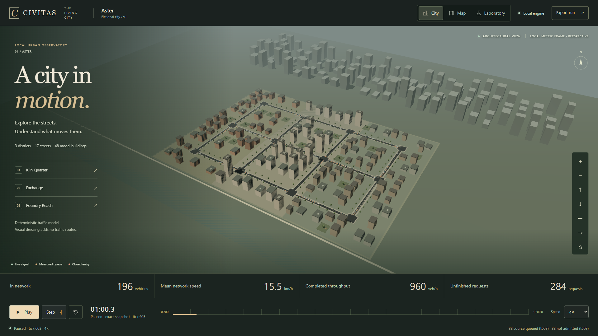

# B06–B08: interactive city implementation and release evidence

**Stage 01 engineering acceptance is complete on the recorded available host.** B06–B08 are implemented on top of B01 and B02–B05 in the existing CIVITAS repository. The traffic engine, contracts, golden fixtures and lockfile are unchanged. The final [machine-readable gate report](evidence/stage01-status.json) has no unresolved Stage 01 gates. Reference-device, actual-mobile and manual assistive-technology limitations remain explicit; this is not full-MVP or universal-device certification.

## Delivered application

- A real React Three Fiber city with the authored Aster geometry, instanced vehicles, signal states, queue overlays, directional closure barriers, architectural dressing, bounded orbit/pan/zoom/focus/reset and a geometry debug view.
- A separately authored SVG map with actual vehicle observations, directional closures, measured queues, districts, model buildings and signal phase/approach inspection. WebGL absence, context loss and slow rendering preserve the worker experiment in Map.
- A charcoal/champagne application shell, network measurement shelf, accessible inspectors, semantic searchable entity list, event log and responsive experiment console. Mobile starts in Map. Reduced motion, shortcut opt-out, visible focus and simple navigation controls are provided.
- Validated 100/200/300-agent inputs for all three standard seeds; acknowledged play/pause/step/speed, directional and atomic two-direction interventions, export/import, verified replay from S0 and explicit worker recovery from the last export.
- Honest demand coverage: source-queued vehicles, in-network agents, not-yet-admitted requests, completed arrivals and unfinished requests remain distinct. Every reducer sample retains definition, scope, units, tick, window, sample count, denominator and quality metadata. Pollution, energy, population, AI recommendations, unmatched comparison and signal-timing intervention are unavailable.

Run `npm ci` and `npm run dev` with Node 24.22.1 / npm 11.19.1, then open <http://127.0.0.1:5173>. The application starts paused. To close a road, choose it in City, Map or Laboratory → Explore, close a named direction, then Step or Play to apply the accepted command. Laboratory → Experiment contains fleet/seed selection, export/import and replay verification. `/foundation` preserves the B01 diagnostic.

[Implementation architecture](architecture.md) describes presentation ownership, interpolation, dressing, fallback and acknowledgement semantics. Stage 02's full cinematic asset pipeline, advanced replay seeking/branching, matched comparison, backend and unimplemented environmental models are excluded.

## Validation protocol and evidence

`npm run verify:stage01` writes raw command output, toolchain identity and the full browser result tree under `evidence/`. It includes every prior deterministic/unit/property and browser replay test. The B01 assertions are retained at their historical diagnostic route; only their navigation target changes to `/foundation`. No test threshold or golden fixture is relaxed.

New unit fixtures cover coordinate transforms, authored right-angle arc sampling within 1 cm, lane/connector traversal boundaries, admission/arrival visibility, discrete closure/signal timing, bounded snapshots, reordering, exact paused endpoints and starvation freezing. Browser flows cover live counts for every fleet, real intervention acknowledgements/effects, export/import/replay, view/camera independence, synthetic 30/60/120 callback pacing, keyboard control, WebGL loss/absence, worker failure/recovery, stale observations, responsive layouts and automated axe checks. Synthetic render callback pacing is explicitly distinct from physical display refresh rates.

The clean `npm ci` used the existing official portable Node 24.22.1 / npm 11.19.1 toolchain and reported 210 packages added, zero vulnerabilities. The host's global Node remains unchanged. A running Vite process initially locked its native binding on Windows; stopping that process allowed clean installation. The local development server was restored on port 5173 after installation.

Development failures are retained in the evidence directory. The first SVG road used a zero-height line hit area; a positive-area hit rectangle fixed Chromium clicking. Firefox additionally exposed a transparent lane overlay intercepting clicks; that informational overlay now ignores pointer events. Axe found an accessible-name mismatch on the brand link; its redundant label was removed. Historic replayed closure events were also prevented from appearing as newly applied intervention notices. These corrections preserve the underlying assertions.

## Performance measurement boundaries

| Preset / speed | Frame p95 | Renderer work p95 | Selection p95 | Command ACK p95 | Page + worker heap | Draw calls / triangles |
| -------------- | --------- | ----------------- | ------------- | --------------- | ------------------ | ---------------------- |
| Standard / 1×  | 16.7 ms   | 1.4 ms            | 43.1 ms       | 3.7 ms          | 31.65 MiB          | 25 / 94,062            |
| Standard / 4×  | 16.7 ms   | 1.4 ms            | 33.9 ms       | 5.5 ms          | 69.86 MiB          | 25 / 94,566            |
| Reduced / 1×   | 16.8 ms   | 1.1 ms            | 32.8 ms       | 4.4 ms          | 32.31 MiB          | 19 / 32,486            |
| Reduced / 4×   | 16.7 ms   | 1.1 ms            | 29.5 ms       | 3.2 ms          | 70.42 MiB          | 19 / 32,990            |

These four uninstrumented frame samples preceded the final same-interval trip re-admission visibility correction. Their original asset identities and raw results are retained. The correction adds lifecycle-aware interpolation for an agent that arrives and is re-admitted between publications; it changes no road, vehicle profile, material, worker transport or simulation behavior. A new unit fixture proves the recorded arrival/admission boundaries, the 300-agent flow is repeated in all browsers, and separate final-build CPU traces include actual frame intervals, heap, draw counts and SHA-256 asset identities after the correction. Earlier CPU traces are preserved locally under `artifacts/local/pre-reentry-trace` and their summary is retained in `main-thread-work.pre-reentry-fix.json`.

All four ordinary interaction samples had zero recorded main-thread long tasks. Snapshot maxima remain below 6.4 KiB, with three buffered per presentation boundary. The final headless 300-agent / 9,000-tick sample took **11.062 s** with tick p50/p95/p99 **0.603 / 1.111 / 2.046 ms**, zero safety corrections/emergency violations and the same final state/event digests as the retained engine evidence. It reached 281 in-network vehicles at tick 8857. Artifact size was **31,711,338 bytes**: checkpoints 19,449,113; events 974,255; metrics 5,700,156; transition ledger 5,113,200; remaining bytes are authenticated inputs/header.

The conservative gzip sum of every emitted JavaScript asset, including the optional foundation probe and worker, is approximately **434 KiB**; adding CSS and the 300-agent input is approximately **484 KiB**. Cold control readiness measured **1.30–1.41 s** under 10 Mbps / 100 ms RTT emulation. That startup measurement uses the default 200-agent initial load; each renderer benchmark subsequently initializes 300 agents. This is four cold startup observations, not a universal loading guarantee.

Hardware samples use production assets, Chromium with Direct3D11 on the available Intel Iris Xe GPU, 300 configured agents, seed 104729, Standard at 1920×1080 / DPR 1 and Reduced at 1280×720 / DPR 1, at both 1× and 4×. Each run warms for 60 s and samples for 120 s. The raw reports record browser/OS/CPU/RAM/power, asset identities, frame interval/FPS distributions, renderer JavaScript work, long tasks, selection feedback, acknowledgement latency, real vehicle counts, intervention outcomes, draw calls, triangles, geometry/texture counts and total page-plus-worker heap.

Default headless Chromium used Google SwiftShader, so that initial slow result is not represented as Iris Xe performance. The Windows Playwright Chromium configuration explicitly requests D3D11; the measured renderer string is retained. GPU allocations are resource-size estimates, and GPU timings are unavailable. R3F/Three.js callback/render work is measured separately from asynchronous React/application work; it is not silently presented as complete main-thread attribution. Actual mobile hardware, NVDA and physical Safari/VoiceOver are not available in this automated session.

The hardware collector is opt-in: set `CIVITAS_RENDER_PERF=1` and run `npx playwright test tests/e2e/render-performance.spec.ts --project=chromium --workers=1`. Default browser validation lists these four hardware cases per project as explicitly skipped. The complete main-thread trace is separately enabled with `CIVITAS_MAIN_TRACE=1` and `npx playwright test tests/e2e/main-thread-trace.spec.ts --project=chromium --workers=1`. It warms the scene once for 60 s, then records 120 s at 1× followed by 120 s at 4× on that same warmed scene. It unions all top-level renderer-main tasks between actual animation-frame callbacks, including React, message handling, browser work and tracing overhead, providing a conservative application-work upper bound. Raw traces are gzip-compressed independently of the 32 MiB simulation artifact limit. `npm run evidence:stage01` checks available measurements and returns a nonzero status when required evidence or budgets remain unresolved. It cannot create a passing release from missing results.

## Stage 01 disposition and Stage 02 readiness

The final source passes strict type checking, lint, formatting, all **88 unit tests**, and the retained **four property tests**. The reconciled browser matrix contains **60 passing functional/replay/accessibility cases** across Chromium, Firefox and WebKit, with zero unresolved failures. The initial broad run retained one WebKit timeout in the synthetic high-cadence Standard stress case; the 45-case follow-up uses explicit DPR 1 / Reduced rendering and keyboard stepping for cadence verification, retains the same equal-tick hash assertions and 90 s timeout, and passes all three browsers. The final re-entry correction additionally passes its analytical regression and the 300-agent flow in all three browsers. Every original 9,000-tick repeat/replay case passed; they are not replaced by short UI tests. Original failures and subsequent successful results remain separately recorded.

The four dedicated uninstrumented hardware cases and the final-build CPU-trace case all pass. Final-build total renderer-main task work p95 is **3.44 ms at 1×** and **4.29 ms at 4×**, including React, message handling, browser work and trace overhead, below the 6 ms gate. Corresponding actual animation-frame interval p95 is **17.75 / 17.84 ms**, with instrumentation. Final-build collected page-plus-worker heap is **24.73 / 46.62 MiB**; final draw calls remain **25**. Raw trace data, complete distributions and asset SHA-256 identities are retained in [the final main-thread report](evidence/main-thread-work.json). The aggregate's conservative GPU allocation estimates account for the observed four-sample Standard MSAA buffer: approximately **94.23 MiB Standard / 12.87 MiB Reduced** at the measured backing dimensions. These are estimates, not GPU allocation measurements, and supersede the raw collector's simpler approximation.

| Stage 01 gates                           | Disposition / evidence                                                                                                                                                                                            |
| ---------------------------------------- | ----------------------------------------------------------------------------------------------------------------------------------------------------------------------------------------------------------------- |
| SIM-01–13, REP-01–03/05, MET-01–03/05/06 | Retained deterministic engine fixtures, property tests, prior three-seed/fleet matrix, all three full browser repeat/replay cases and current 300-agent headless sample; pure-engine source fingerprint unchanged |
| REP-04/06, SYS-01–03                     | Exact equal-tick scheduler tests, synthetic presentation cadence, view/preset/camera independence, stale epochs, bounded imports, stalls, failure/recovery and production worker tests                            |
| SYS-04/05                                | Path/coordinate/connector/lifecycle fixtures, same-publication arrival/re-admission regression, starvation freezing, exact pause/step and scene/view independence                                                 |
| MET-04, INT-01/02, FALL-01               | Real closure/reopen/export/import/replay flows, semantic/keyboard operation, metadata tables, fleet count reconciliation, SVG-only operation and real context loss in all three browsers                          |
| BUILD-01                                 | Clean pinned installation, strict checks, all retained tests, production bundling, follow-up browser results and source-compatible replay                                                                         |
| PERF-01/03/05/08                         | Headless timing/artifact budget, four hardware samples, final complete main-thread traces, page-plus-worker heap, bounded snapshots and conservative resource estimate                                            |
| PERF-02/04/07                            | Preliminary Stage 01 results meet the measured targets; final cinematic rendering and full-MVP reference-device certification remain later-stage work                                                             |

`npm run evidence:stage01` exits 0 for this evidence bundle. No test threshold, golden fixture, traffic semantic or acceptance requirement was changed to obtain that result. Human art review, manual NVDA/VoiceOver, an actual mid-range mobile device, the specified older reference CPU, 30-minute retention testing and advanced replay/comparison remain explicit later-stage/release work. Automated axe and emulated viewports do not establish full WCAG conformance or physical-device performance.

Stage 02 can build on the established ownership boundary, exact geometry, interpolation, camera controls, scene/fallback equivalence and real intervention loop. Its next work should be reviewed licensed font/material assets, facade variety and environmental composition, human art review at overview/road/vehicle/closure views, actual mobile and assistive-technology sessions, and closing any remaining measured performance gate. Those changes must preserve the authoritative graph, conservation and replay tests. No new backend, artificial traffic topology or fictional environmental metrics are prerequisites.
