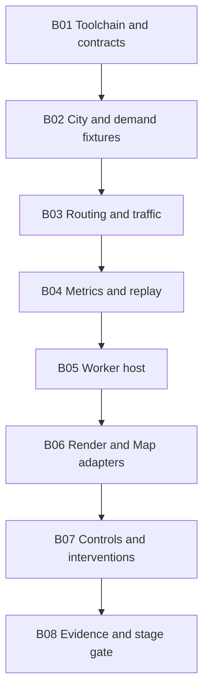

# CIVITAS — Stage 01 build plan

Status: implementation plan retained as the acceptance reference. B01–B08 are implemented and Stage 01 engineering acceptance passes on the recorded available host. [The current report](b06-b08/README.md) retains exact measurements, evidence provenance and device/accessibility limitations. Stage 02 and full-MVP gates remain separate.

## Deliverable and exclusions

Deliver one working engineering slice: Aster's three districts, connected 34-lane network, 48 simple building masses, 100/200/300-agent deterministic traffic, signals and conservative reservations, directed road close/reopen, measured congestion, a worker-driven interpolated R3F scene, functional Map mode, and reproducible artifact export/import/replay.

The slice must be inspectable and credible with simple visuals. Final cinematic assets/effects, interactive checkpoint seeking, branch/comparison UI, local recovery storage, FastAPI, PostgreSQL/PostGIS, energy, pollution, multiplayer, and external data are excluded. Internal checkpoint round-trip tests remain required now. Stage 01 cannot claim complete-MVP acceptance.

## Dependency baseline

Registry metadata was queried on **2026-10-28** without installing packages. These are exact **proposed** pins, not a tested lockfile or compatibility result. The Stage 01 first task must resolve the complete dependency tree, verify peers including optional peers, create a lockfile, and prove a clean production worker build. Record any required change as a reviewed dependency amendment before proceeding. Do not use `--force`, `--legacy-peer-deps`, or broad overrides to hide a conflict.

Toolchain target: **Node 24.22.1 LTS**, bundled **npm 11.19.1**, npm workspaces, and one `package-lock.json`. Pin Node in `.node-version` and `engines`, npm in `packageManager`; keep the runtime identity in test reports. Node's [release policy](https://nodejs.org/en/about/previous-releases) favors supported LTS lines. Registry/release metadata came from the [Node release index](https://nodejs.org/dist/index.json).

Runtime dependencies:

| Package | Proposed exact pin | Location and reason |
| --- | --- | --- |
| `react` | `19.3.1` | Web shell and R3F-compatible major |
| `react-dom` | `19.3.1` | DOM renderer, same React version |
| `three` | `0.186.1` | WebGL2 renderer, geometry, instancing, built-in OrbitControls addon |
| `@react-three/fiber` | `9.8.2` | React scene composition; stable v9 line |
| `zustand` | `5.0.16` | UI state and summary selectors |
| `zod` | `4.6.7` | Contract and imported-artifact validation |

Development dependencies:

| Package | Proposed exact pin | Reason |
| --- | --- | --- |
| `vite` | `8.3.5` | Web and module-worker build |
| `@vitejs/plugin-react` | `6.1.2` | React transform/HMR; no React Compiler configuration initially |
| `typescript` | `6.0.3` | Compatible compiler baseline; intentional hold below TypeScript 7 |
| `@types/react` | `19.3.0` | React types |
| `@types/react-dom` | `19.3.0` | DOM renderer types |
| `@types/three` | `0.186.0` | Matching Three.js release family |
| `@types/node` | `24.19.2` | Node 24 types, rather than unrelated current-major types |
| `vitest` | `5.0.5` | Unit, contracts, reducer, replay tests |
| `fast-check` | `4.10.2` | Generated invariant and command-sequence tests |
| `@playwright/test` | `1.64.1` | Production-build browser/worker tests |
| `@axe-core/playwright` | `4.14.0` | Automated semantic UI accessibility checks |
| `tsx` | `4.23.15` | Headless TypeScript runner and fixture/report scripts |
| `eslint` | `10.13.0` | Flat-config linting and import boundaries |
| `@eslint/js` | `10.0.1` | Base recommended rules |
| `typescript-eslint` | `8.72.1` | Typed linting |
| `eslint-plugin-react-hooks` | `7.1.1` | Hook correctness |
| `eslint-plugin-react-refresh` | `0.5.7` | Component export/HMR checks |
| `globals` | `17.13.0` | Explicit browser, worker, and Node global boundaries |
| `prettier` | `3.9.10` | Source/document formatting |

Metadata checks found that `typescript-eslint@8.72.1` accepts TypeScript `>=4.8.4 <6.1.0`, while the registry's latest TypeScript was `7.0.2`. This is why the plan chooses `6.0.3`. R3F metadata accepts React `>=19 <19.4`; the proposed React version fits that peer range. Range compatibility is necessary but does not prove runtime integration. Sources: [typescript-eslint registry metadata](https://registry.npmjs.org/typescript-eslint/8.72.1), [R3F registry metadata](https://registry.npmjs.org/@react-three%2Ffiber/9.8.2), and [R3F installation guidance](https://r3f.docs.pmnd.rs/getting-started/installation).

For the remaining exact versions, use the official npm registry endpoint `https://registry.npmjs.org/{package}/{version}` and record the package-lock integrity fields at installation. Vite and Vitest runtime requirements are documented in [Vite's guide](https://vite.dev/guide/) and [Vitest's guide](https://vitest.dev/guide/). The selected Node line meets their documented minimums. Optional React Native/Expo peers do not authorize installing a mobile stack. Optional Babel/compiler peers should be installed only if the selected plugin path actually requires them, then pinned and documented.

No extra runtime dependency is planned for routing, physics, PRNG, hashing, camera controls, icons, charts, HTTP, maps, or animation. Implement the small specified algorithms in the core; use browser/Node Web Crypto for SHA-256 at boundaries, Three.js addons for orbit control, CSS for interface transitions, and local SVG for simple icons/map. PRNG code needs an attributed reference and golden vectors. Future Python packages and database versions are selected only when Stage 04 is authorized; they are not Stage 01 prerequisites.

## Task graph



The order is intentional: do not make the scene simulate traffic while waiting for a worker implementation. Each task leaves concrete reviewable artifacts. The sequence describes engineering dependencies, not delegated agent work.

## B01 — toolchain, contracts, and boundaries

Create the workspace layout in [architecture](architecture.md#planned-repository-layout), excluding future service directories. Hand-author a minimal React/TypeScript Vite app or copy the minimal official template into `apps/web`; preserve all Stage 00 docs. Add exact pins, lockfile, strict TypeScript configs, ESLint flat config, format checks, and test scripts. Separate DOM, WebWorker, and Node lib/type environments. Core code cannot import browser or renderer modules.

Define versioned IDs/units, city/scenario/manifest schemas, command/observation unions, checkpoint schema, and metric definitions. Add `.env.example` only if a real local setting is needed; the MVP must not need secrets.

Acceptance: BUILD-01 for installation/typecheck/build skeleton, SYS-01, invalid schema fixtures. Verify lockfile peers and Node/TS/linter compatibility before substantial work. The production module-worker smoke test is completed again at B05/B08.

## B02 — city compiler and reproducible demand

Create `data/aster/city.v1.json`, `scenario.morning.v1.json`, and headless generators/validators. Author the exact 12-node grid, lane/connector geometry, district polygons, and 48 building footprints with setbacks. Keep appearance parameters separate from topology. Implement stable graph compilation and references.

Implement versioned xoshiro128** with reviewed reference vectors, seed expansion, independent streams, and unbiased integer sampling. Generate complete fixed itineraries for the three fleet sizes and standard seeds. Store compact reviewed fixtures for regression, rather than committing bulky generated run output.

Acceptance: SIM-01, SIM-04, SIM-05 graph validation, SIM-13 manifest equality. Emit an input-validation report with counts/hashes labeled as fixture metadata, not simulated outcomes.

## B03 — routing, demand lifecycle, traffic, and interventions

Implement stable Dijkstra, route caching/versioning, scheduled demand/source queues, agent conservation, IDM/ballistic integration, virtual barriers, body footprints, one-owner intersection tokens, outgoing entrance holds, signal counters, and atomic lane close/open. Follow the exact transition order in [the specification](simulation-spec.md#transition-order).

Use double-buffered proposals and explicit stable resolution. Include arrival/sink semantics, remaining-route repair, disconnected-route waiting, and prior-reservation closure exceptions. Add invariant checking to test/debug runs and diagnostic counters to artifacts. Preserve all blocked demand. A visually desirable flow does not justify disabling safety checks.

Acceptance: SIM-02 through SIM-12 as applicable. First run small analytical fixtures, then the full 9,000-tick Aster cases. Record the first actual traffic evidence here; do not declare predicted congestion levels in advance.

## B04 — metrics, event log, canonical artifacts, and replay

Implement versioned derived events, integer distance/vehicle-time accounting, rolling windows, requested vs admitted travel time, delay, censoring/backlog counts, and district splits. Implement canonical state serialization, SHA-256 checkpoints every 100 ticks, export/import, and deterministic replay from S0. Include pending commands, signal/reservation state, queue counters, route retries, and metric ring buffers in checkpoints.

Add a headless runner accepting scenario, manifest/seed, fleet, command fixture, and exact end tick. It writes an artifact plus a separate timing/compatibility report. Validate imported files before state restoration. Build internal checkpoint restore now; defer timeline/branch UI.

Acceptance: REP-01, REP-02, REP-03, REP-06 boundary validation, MET-01 through MET-06, PERF-08. Report exact-runtime guarantees and mismatches candidly. Do not make independent copies of dynamics for the headless runner.

## B05 — worker host and application bridge

Wrap the same core in a dedicated module worker using Vite's static worker URL pattern. Implement scheduler budgets, control acknowledgements, event/metric batches, snapshot cadence, epoch isolation, and explicit worker failures. Main-thread bridge exposes commands and read-only observation subscriptions. Buffer at most three render snapshots; clone initially and measure bytes/time before optimizing.

Implement visibility/wall-gap auto-pause, achieved-speed reporting, paused stepping, reset/import lifecycle, and bounded export assembly. Expose an explicit test observation interface for browser tests without allowing production direct state mutation.

Acceptance: SYS-02, SYS-03, REP-04, REP-06 lifecycle tests, actual production worker-load smoke, and preliminary PERF-01/03/05. Delaying a command acknowledgement is not permission for the interface to assume it applied.

## B06 — simple R3F scene and independent Map view

Create a ground plane, road geometry, junction stop lines, 48 neutral building extrusions, instanced vehicle bodies, and signal indicators. Add bounded overview/orbit/focus controls using Three.js addons. Build snapshot-to-path interpolation and stable instance-ID mapping; `useFrame` may update transforms but may not advance agents or accumulate metrics.

Create a separately rendered SVG road map, semantic entity list, and metric table using the same snapshots. Add WebGL2 capability detection, explicit Standard/Reduced/Map choice, and context-loss recovery to Map. Use basic readable materials and system fonts; full art direction belongs to Stage 02.

Acceptance: SYS-04, SYS-05, FALL-01, metric display consistency, preliminary performance traces. Compare state hashes during camera movement and across view/preset changes. Test an actual corner transition to catch interpolation through buildings.

## B07 — semantic controls, selection, and intervention flow

Add play/pause, one-tick step, speed selection, seed/scenario identity, exact tick, road direction selection, inspector, close/open commands, and pending/applied/rejected event feedback. Provide keyboard operation, visible focus, reduced-motion setting, and touch/drag alternatives. Expose raw metric definitions and null states. Keep energy/pollution unavailable.

Add export, validated import, and replay-from-start controls. Confirm only destructive reset of an unsaved experiment; closing/reopening roads is the normal reversible experiment flow. Display prior commitments draining rather than falsely asserting the road is empty immediately.

Acceptance: INT-01, INT-02, MET-04, MET-06, FALL-01; initial axe checks and a keyboard-only manual flow. Stage 01 functional accessibility is required even though full conformance review comes later.

## B08 — end-to-end evidence and review

Run the complete Stage 01 gate against the production build and headless core. Exercise all three standard seeds and fleet sizes, the closure/reopen case, disconnected and zero-demand fixtures, and renderer-starvation cases. Compare exact hashes within each runtime and report cross-runtime differences. Measure budgets on the stated reference class or record a hardware-blocked performance gate; do not substitute headless software rendering for GPU acceptance.

Deliver source/lockfile, actual command output, run artifacts, state/event hashes, diagnostics, screenshots, accessibility notes, performance traces, compatibility matrix, and unresolved failures. Update the dossier if implementation discovers a genuine model limitation. Request Stage 02 only after the slice is concrete and reviewable; do not begin it implicitly.

## Required fixtures

| Fixture | Purpose | Acceptance references |
| --- | --- | --- |
| Straight lane / prescribed acceleration | Integrator units, stop distance, free-road dynamics | SIM-06/07 |
| Leader-stop and red-gate | Safe following, queue threshold, release | SIM-07/08/12, MET-02 |
| Diamond routing graph / equal alternatives | Known route cost, deterministic tie-break, closure | SIM-05/10 |
| Full outgoing lane / occupied connector | Finite storage, space holds, all-red clearance | SIM-08, REP-03 |
| Disconnected corridor | No-route demand accounting and reopening | SIM-11 |
| Hand-authored metric traces | Independent window arithmetic, nulls, percentiles | MET-01/03/05 |
| Aster baseline and closure | Real city-scale causality, conservation, replay | SIM-02/03/09/13, REP-01–05 |
| Invalid/stale/corrupt artifacts | Schema, limits, hashes, epochs, rejection | REP-06 |
| Turn snapshots and delayed worker | Path interpolation and stale rendering | SYS-03/04 |
| WebGL-disabled/context-lost browser | Equivalent fallback interventions and evidence | FALL-01 |

## Planned commands and scripts

These are the exact root script interfaces B01/B04 must implement. They are documentation now; no `package.json` or executable script exists in Stage 00.

```powershell
npm ci
npm run format:check
npm run typecheck
npm run lint
npm run test:unit
npm run test:properties
npm run sim:verify -- --seeds 104729,130363,155921 --fleets 100,200,300 --ticks 9000
npm run build
npm exec playwright install chromium firefox webkit
npm run test:e2e
npm run test:a11y
npm run perf:headless -- --fleet 300 --ticks 9000
npm run evidence:stage01
```

`test:e2e` must run against `vite preview` of the production build via Playwright `webServer`, including real module workers. `test:a11y` runs axe checks on functional Stage 01 views; manual keyboard/screen-reader evidence is recorded separately. `sim:verify` checks hashes, invariants, artifact round trips, and closure fixtures, not just process exit status. `evidence:stage01` assembles existing results and exits nonzero for missing/failed required gates; it cannot manufacture a pass.

Browser download tools are local development dependencies, not paid services. CI may use native Linux/Windows runners without containers. Real-GPU performance and assistive-technology reviews remain explicit review tasks.

## Stage 01 exit checklist

- Every Stage 01 SIM, REP, MET, SYS, INT, FALL, BUILD, and designated PERF gate passes or is explicitly reported as unresolved; unresolved required gates prevent completion.
- The 300-agent baseline demonstrates at least 100 simultaneously in-network vehicles, with actual peak/tick evidence.
- One exported closure/reopen experiment replays exactly in its declared compatible runtime and explains queues, reroutes, draining exceptions, and blocked demand through recorded state.
- Orbiting, changing FPS, switching Map/City, and requested speed changes do not change equal-tick simulation outcomes.
- Clean installation and production worker bundling are demonstrated using the committed lockfile.
- No backend, container, paid API, invented energy/pollution value, or full application scope has entered the slice.

The next authorized stage would then be Stage 02 art and interaction completion, followed by Stage 03 full-MVP replay/comparison and release verification.
